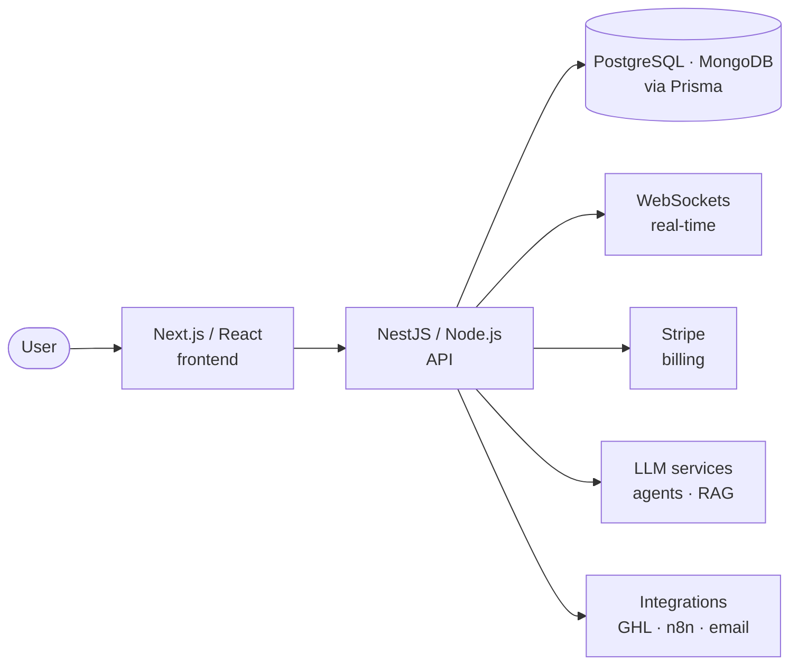

<!--
  Muhammad Anas Fazal (Anas Fazal Awan) — GitHub profile README
  Repo: github.com/anasfazalawan/anasfazalawan
-->

<div align="center">


<br/>

<a href="https://anas-fazal-portfolio.vercel.app/"></a>
<a href="https://www.linkedin.com/in/anasfazalawan/"></a>
<a href="mailto:anasfazalawan@gmail.com"></a>
<a href="https://wa.me/923176894632"></a>
<a href="https://anas-fazal-portfolio.vercel.app/Muhammad-Anas-Fazal-Resume.pdf"></a>

</div>

<br/>

```console
anas@github:~$ whoami
Muhammad Anas Fazal (Anas Fazal Awan) — Full Stack AI Developer, Lahore, Pakistan

anas@github:~$ cat now.md
→ Full Stack AI Developer at Get AI Chatbots (GAC)
→ Building full-stack apps with Next.js, Node.js and Python, with AI built in
→ Deploying on Azure, AWS and Replit

anas@github:~$ cat ask-me-about.md
Next.js & NestJS · API design · real-time apps · Stripe billing · LLM apps & RAG · GHL & n8n
```

## 👋 About

I'm a **full-stack engineer who builds AI into real products**. Most of my work is end-to-end web apps (Next.js and React on the front, NestJS and Node.js on the back, Postgres or MongoDB underneath) with LLM features, payments and integrations where they add value.

My story didn't start with code. It started with words: Urdu debate, poetry, and co-authoring a published book. That's still how I build. Every system should tell a clear story: clean architecture, purposeful APIs, and AI that actually helps people.

<table>
<tr>
<td valign="top" width="50%">

**🧠 What I'm focused on**
- Production full-stack apps with Next.js + NestJS
- Clean APIs, real-time features and payments
- AI features: LLM agents, RAG and function calling
- Integrations & automation (GHL, n8n) when a project needs them

</td>
<td valign="top" width="50%">

**⚡ Quick facts**
- 📍 Lahore, Pakistan
- 💼 Full Stack AI Developer @ **Get AI Chatbots**
- 🎓 BS Software Engineering, **COMSATS Islamabad**
- 🏆 FYP **SmartCUI**: 3rd place, CUI Project Expo '24
- 🗣️ English · Urdu

</td>
</tr>
</table>

## 🏗️ How I usually build



## 🛠️ Tech stack

<p align="center">
  
  <br/>
  
</p>

<p align="center">
  
  
  
  
  
  
  <br/>
  
  
  
  
  
  
  
</p>

## 💼 Experience

| Role | Company | When | What I do / did |
|---|---|---|---|
| **Full Stack AI Developer** | Get AI Chatbots (GAC) | Sep 2026 – Present | LLM agents & automation workflows with GHL, n8n and agentic frameworks; Next.js + Node.js/Python; Azure, AWS, Replit |
| **Software Engineer** | Empeer Devlab | Jun 2025 – Aug 2026 | React/Next.js + NestJS + Prisma; Stripe subscriptions & webhooks; Gemini & AWS Nova function calling; GitHub Actions CI/CD |
| **Software Engineer Intern** | AKSA SDS | Mar 2025 – May 2025 | Node.js/Express/MongoDB e-commerce backend, 3-tier RBAC, Redis & RabbitMQ queues |

## 🚀 Featured work

<table>
<tr>
<td width="50%" valign="top">

### [Convertinar](https://convertinar.com) ↗
AR product visualization: 3D models in AR from a QR scan.<br/>
Stripe subscription billing, RBAC, AWS S3 versioned storage, analytics, Jest.

<sub>`React` `NestJS` `Stripe` `AWS S3` `Prisma`</sub>

</td>
<td width="50%" valign="top">

### [Digital Doctor Pakistan](https://www.digitaldoctorpakistan.com/en) ↗
Doctor booking, medicines and lab tests with real-time availability.<br/>
WebSocket sync, WhatsApp & email OTP, cron reminders.

<sub>`Next.js` `Node.js` `Redux` `WebSockets`</sub>

</td>
</tr>
<tr>
<td width="50%" valign="top">

### SmartCUI 🏆
AI job & career platform: mock interviews, skill tests, ATS resume analyzer, 5-tier RBAC.<br/>
3rd place, COMSATS Project Expo Fall '24.

<sub>`Next.js` `Node.js` `MongoDB` `LLMs`</sub>

</td>
<td width="50%" valign="top">

### TaskIQ · AI Bus Booking Agent
Meeting transcripts → action items via Gemini function calling.<br/>
Voice/text ticket booking agent for Knutsford Express.

<sub>`NestJS` `Gemini` `FastAPI` `Socket.IO`</sub>

</td>
</tr>
</table>

## 📈 GitHub activity

<p align="center">
  
</p>

<p align="center">
  
</p>

<p align="center">
  
</p>

## 🎤 Beyond the code

- **Founder & Ex-President, C3.CUI** (2022–2024): built a student community from zero; flagship events (national-level Mushairas, Qawwali Nights, tech bootcamps) with **10,000+ attendees** in total.
- **TEDxCUI**: **Operations Manager** (2023) and **Co-Organizer** (2024).
- **Campus Ambassador, Huawei ICT** (2023–2024).
- **Published author**: co-wrote *Melancholic Phases* (INDC, 2022).
- **Competitive Urdu debater**: district-level wins, divisional-level representation.

I also give **talks and hands-on workshops** on full-stack development and building with AI. [Invite me →](https://anas-fazal-portfolio.vercel.app/#contact)

## 🤝 Let's work together

<div align="center">

**Full-stack web apps · AI development · automation (GHL & n8n) · talks & workshops**

<a href="https://anas-fazal-portfolio.vercel.app/services"></a>
<a href="https://wa.me/923176894632"></a>
<a href="mailto:anasfazalawan@gmail.com"></a>

<br/><br/>


<sub><i>"The surface is never the full story."</i></sub>

</div>
